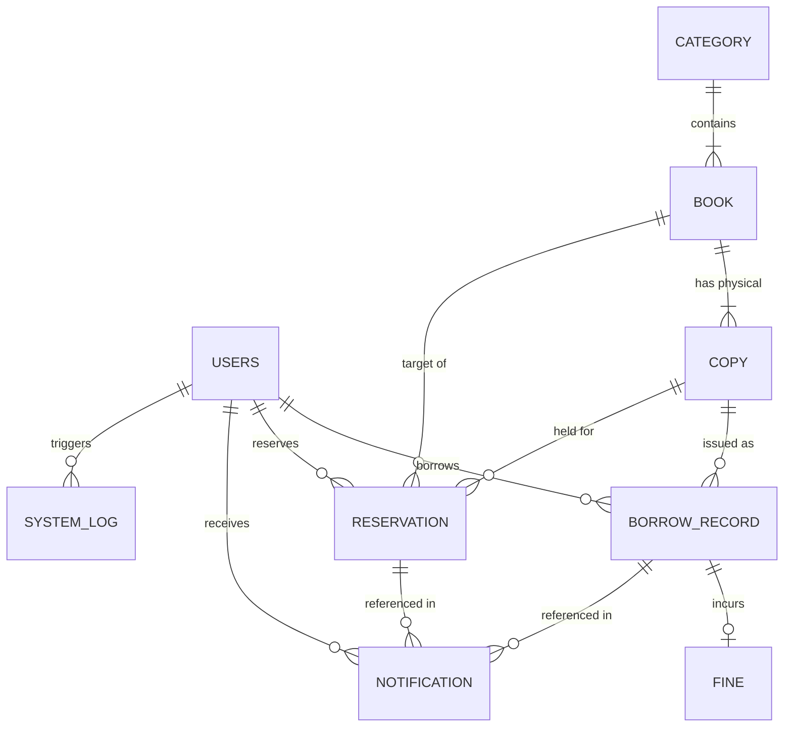

# UniLibrary Management System &middot; Database Schema Specification

This document provides the complete database schema, entity-relationship specifications, and data dictionary for the **University Library Management System with Automated Book Reservation and Overdue Notifications**.

---

## 1. Entity-Relationship Diagram (ERD)

---

## 2. Table-by-Table Data Dictionary

### Table 1: `Users` (`accounts_user`)
Stores user accounts for Students, Librarians, and System Administrators.

| Column | Data Type | Nullable | Key / Constraint | Description |
|---|---|:---:|:---:|---|
| `id` | `BIGINT` | No | **PK**, Auto Increment | Unique internal user ID |
| `email` | `VARCHAR(254)` | No | **Unique**, Indexed | User university email address (primary login identifier) |
| `full_name` | `VARCHAR(150)` | No | | User's full name (e.g. "Isaac Umoh") |
| `matric_number` | `VARCHAR(30)` | Yes | **Unique** (sparse), Indexed | Student matriculation number (e.g. `2022/241230`), null for staff |
| `role` | `VARCHAR(20)` | No | Enum (`STUDENT`, `LIBRARIAN`, `ADMINISTRATOR`) | Role-based authorization level |
| `password` | `VARCHAR(128)` | No | PBKDF2/SHA256 Hash | Securely hashed user password |
| `is_active` | `BOOLEAN` | No | Default `TRUE` | Whether the user account is active or deactivated |
| `is_staff` | `BOOLEAN` | No | Default `FALSE` | Access flag for administrative interfaces |
| `date_registered` | `DATETIME` | No | Auto-now-add | Timestamp when user registered |
| `last_login` | `DATETIME` | Yes | | Timestamp of the most recent login |

---

### Table 2: `catalogue_category`
Stores subject classification departments (e.g., Computer Science, Engineering, Law).

| Column | Data Type | Nullable | Key / Constraint | Description |
|---|---|:---:|:---:|---|
| `id` | `BIGINT` | No | **PK**, Auto Increment | Unique category ID |
| `category_name` | `VARCHAR(100)` | No | **Unique** | Name of the subject category |
| `code` | `VARCHAR(10)` | No | **Unique** | Short shelf prefix code (e.g., `CS`, `ENG`, `LAW`) |

---

### Table 3: `catalogue_book`
Stores bibliographic records for library textbooks.

| Column | Data Type | Nullable | Key / Constraint | Description |
|---|---|:---:|:---:|---|
| `id` | `BIGINT` | No | **PK**, Auto Increment | Unique book ID |
| `title` | `VARCHAR(255)` | No | Indexed | Book title |
| `author` | `VARCHAR(255)` | No | Indexed | Authors / Editors of the book |
| `isbn` | `VARCHAR(20)` | No | **Unique**, Indexed | Standard ISBN-10 or ISBN-13 |
| `category_id` | `BIGINT` | No | **FK** &rarr; `catalogue_category.id` | Subject category classification |
| `description` | `LONGTEXT` | Yes | | Book synopsis and overview |
| `cover_image` | `VARCHAR(100)` | Yes | | Path to uploaded front cover image |
| `created_at` | `DATETIME` | No | Auto-now-add | Timestamp when catalogued |

---

### Table 4: `catalogue_copy`
Stores individual physical inventory copies of each book on the library shelves.

| Column | Data Type | Nullable | Key / Constraint | Description |
|---|---|:---:|:---:|---|
| `id` | `BIGINT` | No | **PK**, Auto Increment | Accession index; formats as `C0001`, `C0002` |
| `book_id` | `BIGINT` | No | **FK** &rarr; `catalogue_book.id` | The parent title of this physical copy |
| `whereabouts` | `VARCHAR(100)` | No | Default `'Main Shelf'` | Physical shelf location in library |
| `status` | `VARCHAR(20)` | No | Enum (`AVAILABLE`, `BORROWED`, `RESERVED`, `WITHDRAWN`) | Live physical circulation state |
| `date_added` | `DATE` | No | Auto-now-add | Date this copy was added to circulation |

---

### Table 5: `circulation_borrowrecord`
Tracks physical loan transactions, checkout due dates, and return history.

| Column | Data Type | Nullable | Key / Constraint | Description |
|---|---|:---:|:---:|---|
| `id` | `BIGINT` | No | **PK**, Auto Increment | Unique loan transaction ID |
| `student_id` | `BIGINT` | No | **FK** &rarr; `Users.id` | Student borrower |
| `copy_id` | `BIGINT` | No | **FK** &rarr; `catalogue_copy.id` | Physical copy issued |
| `reservation_id` | `BIGINT` | Yes | **FK** &rarr; `reservations_reservation.id` | Fulfilled reservation if issued from a hold |
| `issued_by_id` | `BIGINT` | No | **FK** &rarr; `Users.id` | Librarian who performed checkout desk issuance |
| `borrow_date` | `DATE` | No | | Date book was checked out |
| `due_date` | `DATE` | No | Indexed | Scheduled return deadline |
| `return_date` | `DATE` | Yes | Indexed | Actual return date; `NULL` while active loan |
| `renewal_count` | `INT` | No | Default `0` | Number of times renewed (max 1) |

---

### Table 6: `reservations_reservation`
Implements the First-Come, First-Served automated reservation queue and 48-hour pickup shelf holds.

| Column | Data Type | Nullable | Key / Constraint | Description |
|---|---|:---:|:---:|---|
| `id` | `BIGINT` | No | **PK**, Auto Increment | Unique reservation ID |
| `student_id` | `BIGINT` | No | **FK** &rarr; `Users.id` | Reserving student |
| `book_id` | `BIGINT` | No | **FK** &rarr; `catalogue_book.id` | Reserved title |
| `copy_id` | `BIGINT` | Yes | **FK** &rarr; `catalogue_copy.id` | Physical copy held at desk (`NULL` while WAITING) |
| `reservation_date` | `DATETIME` | No | Auto-now-add, Indexed | Queue placement timestamp |
| `status` | `VARCHAR(20)` | No | Enum (`WAITING`, `READY`, `FULFILLED`, `CANCELLED`, `EXPIRED`) | Current reservation lifecycle state |
| `notified_at` | `DATETIME` | Yes | | Timestamp when marked `READY` and student notified |
| `expires_at` | `DATETIME` | Yes | | 48-hour pickup deadline timestamp |

* **Unique Constraint**: `unique_active_reservation_per_student_book` on `(student_id, book_id)` where `status IN ('WAITING', 'READY')`.

---

### Table 7: `fines_fine`
Stores overdue fine liabilities, payment audit trails, and authorized librarian waivers.

| Column | Data Type | Nullable | Key / Constraint | Description |
|---|---|:---:|:---:|---|
| `id` | `BIGINT` | No | **PK**, Auto Increment | Unique fine ID |
| `borrow_record_id` | `BIGINT` | No | **FK** (One-to-One) &rarr; `circulation_borrowrecord.id` | Originating overdue loan |
| `amount` | `DECIMAL(10,2)` | No | | Incurred fine amount (₦) |
| `status` | `VARCHAR(20)` | No | Enum (`UNPAID`, `PAID`, `WAIVED`) | Fine settlement status |
| `date_created` | `DATETIME` | No | Auto-now-add | Timestamp generated upon late return |
| `date_paid` | `DATETIME` | Yes | | Timestamp payment or waiver was recorded |
| `recorded_by_id` | `BIGINT` | Yes | **FK** &rarr; `Users.id` | Librarian who recorded payment or waiver |
| `payment_reference`| `VARCHAR(100)` | Yes | | Receipt / teller reference number |
| `waiver_reason` | `LONGTEXT` | Yes | | Administrative justification if waived |

---

### Table 8: `notifications_notification`
Stores multi-channel in-app and email communication sent to library users.

| Column | Data Type | Nullable | Key / Constraint | Description |
|---|---|:---:|:---:|---|
| `id` | `BIGINT` | No | **PK**, Auto Increment | Unique notification ID |
| `user_id` | `BIGINT` | No | **FK** &rarr; `Users.id` | Recipient user |
| `type` | `VARCHAR(30)` | No | Enum (`RESERVATION_READY`, `DUE_SOON`, `OVERDUE`, etc.) | System event code |
| `channel` | `VARCHAR(20)` | No | Enum (`INAPP`, `EMAIL`) | Delivery channel |
| `message` | `LONGTEXT` | No | | Notification message text |
| `is_read` | `BOOLEAN` | No | Default `FALSE` | Read / unread status for in-app badge |
| `date_sent` | `DATETIME` | No | Auto-now-add, Indexed | Dispatch timestamp |
| `borrow_record_id` | `BIGINT` | Yes | **FK** &rarr; `circulation_borrowrecord.id` | Related loan (if applicable) |
| `reservation_id` | `BIGINT` | Yes | **FK** &rarr; `reservations_reservation.id` | Related reservation (if applicable) |

---

### Table 9: `core_setting`
Stores dynamic administrative configuration parameters.

| Column | Data Type | Nullable | Key / Constraint | Description |
|---|---|:---:|:---:|---|
| `setting_key` | `VARCHAR(50)` | No | **PK** | Config key (e.g. `loan_period_days`, `fine_per_day`) |
| `setting_value`| `VARCHAR(255)` | No | | Configured value string |
| `description` | `VARCHAR(255)` | No | | Administrator guidance note |

---

### Table 10: `core_systemlog`
Immutable system audit trail recording operations, administrative actions, and system jobs.

| Column | Data Type | Nullable | Key / Constraint | Description |
|---|---|:---:|:---:|---|
| `id` | `BIGINT` | No | **PK**, Auto Increment | Unique log sequence ID |
| `timestamp` | `DATETIME` | No | Auto-now-add, Indexed | Event occurrence timestamp |
| `user_id` | `BIGINT` | Yes | **FK** &rarr; `Users.id` | Actor who performed action (`NULL` for automated system jobs) |
| `action` | `VARCHAR(50)` | No | Indexed | Event category code (e.g. `LOGIN`, `ISSUE`, `RETURN`, `EMAIL_SENT`) |
| `detail` | `VARCHAR(300)` | No | | Human-readable audit description |

---

## 3. SQL DDL Script

The raw, executable SQL `CREATE TABLE` and constraint statements for MySQL 8.0 have been generated and exported to [schema.sql](file:///c:/Users/Windows/Desktop/PROJECT%20WORK/schema.sql).
